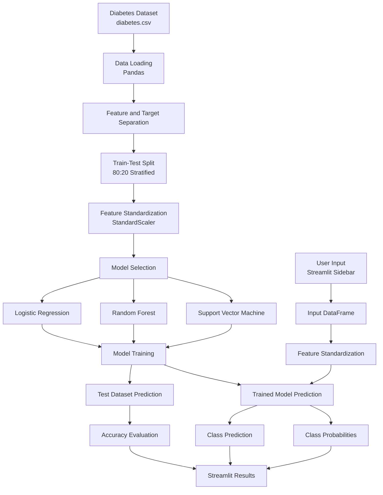
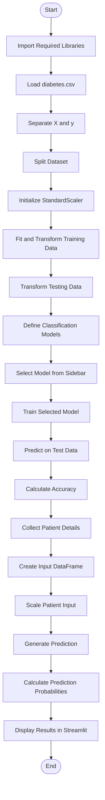
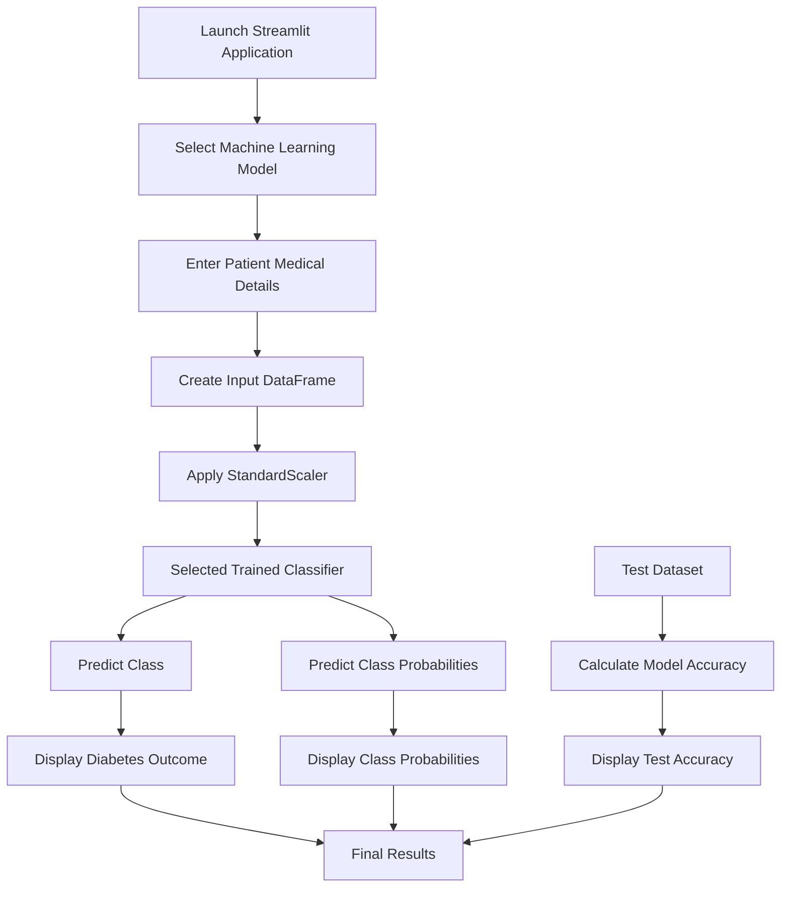

# Diabetes Risk Prediction System
### Multi-Model Machine Learning Classification with an Interactive Streamlit Interface

<p align="center">
  
  
  
  
  
  
</p>

---

## 1. Project Overview

The **Diabetes Risk Prediction System** is a machine learning-based binary classification application designed to predict diabetes outcomes using patient-related medical attributes.

Developed using Python, Scikit-learn, and Streamlit, the application integrates three supervised machine learning algorithms into a single interactive platform.

Users can select a classification algorithm, provide patient information through an interactive interface, and obtain a predicted diabetes outcome along with the estimated probabilities for both classes.

The system also calculates and displays the selected classifier's accuracy on an independent test dataset, allowing users to explore different classification approaches.

### Key Highlights

| Component | Implementation |
|---|---|
| Problem Type | Binary Classification |
| Dataset | Pima Indians Diabetes Dataset |
| Input Features | 8 medical attributes |
| Target Variable | Outcome |
| Classification Models | Logistic Regression, Random Forest, SVM |
| Data Splitting | 80% Training, 20% Testing |
| Data Preprocessing | Standardization |
| Feature Scaling | StandardScaler |
| Evaluation Metric | Accuracy Score |
| Prediction Output | Binary classification |
| Probability Estimation | Class probabilities |
| Frontend | Streamlit |
| Programming Language | Python |

---

## 2. Problem Statement

Diabetes is a chronic metabolic condition that requires timely identification and appropriate medical attention.

Machine learning can be used to analyse medical attributes and identify patterns associated with diabetes outcomes.

The objective of this project is to develop an interactive classification system that:

- Accepts relevant patient medical information.
- Processes input features using standardization.
- Applies different supervised machine learning algorithms.
- Predicts whether the patient belongs to the diabetic or non-diabetic class.
- Displays the estimated probability of each classification.
- Provides a test accuracy measurement for the selected model.

The project demonstrates the application of supervised machine learning techniques to a healthcare-related classification problem.

---

## 3. Objectives

1. Understand and implement a binary classification problem using a real-world medical dataset.
2. Perform feature selection and target variable separation.
3. Apply train-test splitting with stratified sampling.
4. Understand the importance of feature standardization.
5. Implement and compare three machine learning classification algorithms.
6. Generate predictions using user-provided input.
7. Estimate class probabilities using trained classifiers.
8. Develop an interactive web application using Streamlit.
9. Evaluate model performance using accuracy score.

---

## 4. Dataset Description

### Pima Indians Diabetes Dataset

The project uses the Pima Indians Diabetes Dataset, a commonly used dataset for demonstrating binary classification in healthcare analytics.

The dataset contains medical diagnostic measurements and a binary outcome variable.

**Dataset file:** `diabetes.csv`

**Target column:** `Outcome`

### Dataset Features

The dataset contains eight independent variables and one dependent variable.

| No. | Feature | Description | Data Type |
|---:|---|---|---|
| 1 | Pregnancies | Number of times the patient has been pregnant | Integer |
| 2 | Glucose | Plasma glucose concentration | Integer |
| 3 | BloodPressure | Diastolic blood pressure (mm Hg) | Integer |
| 4 | SkinThickness | Triceps skin fold thickness (mm) | Integer |
| 5 | Insulin | Two-hour serum insulin (mu U/ml) | Integer |
| 6 | BMI | Body Mass Index | Float |
| 7 | DiabetesPedigreeFunction | Diabetes Pedigree Function, representing hereditary influence | Float |
| 8 | Age | Age of the patient in years | Integer |
| 9 | Outcome | Diabetes classification label | Binary |

### Target Variable

| Outcome | Classification |
|---:|---|
| 0 | Non-diabetic |
| 1 | Diabetic |

The target variable is used during model training to teach the classifiers to distinguish between the two outcome categories.

---

## 5. Technologies and Libraries

| Technology / Library | Purpose |
|---|---|
| Python | Core programming language |
| Pandas | Dataset loading, manipulation, and DataFrame creation |
| NumPy | Numerical computing |
| Scikit-learn | Machine learning model implementation |
| StandardScaler | Feature standardization |
| train_test_split | Training and testing dataset separation |
| LogisticRegression | Linear classification |
| RandomForestClassifier | Ensemble-based classification |
| SVC | Support Vector Machine classification |
| accuracy_score | Model performance evaluation |
| Streamlit | Interactive web application development |

---

## 6. System Architecture

The application follows a straightforward machine learning pipeline consisting of data ingestion, preprocessing, model selection, training, prediction, and result visualization.

### High-Level Architecture



### Architecture Components

| Component | Responsibility |
|---|---|
| Data Layer | Loads the diabetes dataset |
| Preprocessing Layer | Separates features and target and standardizes the data |
| Model Layer | Implements the three classification algorithms |
| Evaluation Layer | Calculates test accuracy |
| Input Layer | Collects patient information through Streamlit |
| Prediction Layer | Generates the predicted class and class probabilities |
| Presentation Layer | Displays patient information and prediction results |

---

## 7. Machine Learning Workflow

The following workflow describes the complete execution sequence.



### Step-by-Step Workflow

| Step | Operation | Description |
|---:|---|---|
| 1 | Data Loading | Read the CSV dataset using Pandas |
| 2 | Feature Selection | Separate input features and target variable |
| 3 | Data Splitting | Divide the dataset into training and testing sets |
| 4 | Standardization | Scale features using StandardScaler |
| 5 | Model Initialization | Define the three classification algorithms |
| 6 | Model Selection | Allow users to select a classifier |
| 7 | Model Training | Train the selected classifier |
| 8 | Model Evaluation | Predict test labels and calculate accuracy |
| 9 | User Input | Collect patient information |
| 10 | Input Processing | Convert patient details into a DataFrame and standardize them |
| 11 | Prediction | Predict the patient's diabetes outcome |
| 12 | Probability Estimation | Calculate probabilities for both classes |
| 13 | Result Display | Present predictions, probabilities, and accuracy |

---

## 8. Data Preprocessing

Data preprocessing is an essential stage in machine learning because the quality and representation of input data influence model performance.

The following preprocessing operations are implemented.

### 8.1 Feature and Target Separation

The independent variables are stored in `X`, while the dependent variable is stored in `y`.

```python
X = df.drop("Outcome", axis=1)
y = df["Outcome"]
```

- `X`: Contains the eight input features.
- `y`: Contains the target classification labels.

### 8.2 Train-Test Split

The dataset is divided into training and testing subsets.

```python
X_train, X_test, y_train, y_test = train_test_split(
    X,
    y,
    test_size=0.2,
    random_state=42,
    stratify=y
)
```

| Parameter | Value | Purpose |
|---|---|---|
| test_size | 0.2 | Uses 20% of the dataset for testing |
| Training Size | 80% | Used for model training |
| random_state | 42 | Ensures reproducibility |
| stratify | y | Preserves class distribution |

**Why stratified splitting?**

Stratification ensures that the proportion of diabetic and non-diabetic samples is approximately maintained in both training and testing datasets.

This helps avoid an unrepresentative class distribution after splitting.

### 8.3 Feature Standardization

The project uses `StandardScaler` to standardize numerical features.

```python
scaler = StandardScaler()

X_train = scaler.fit_transform(X_train)
X_test = scaler.transform(X_test)
```

Standardization transforms the features so that they have approximately:

- Mean = 0
- Standard Deviation = 1

**Mathematical Formula**

\[
z = \frac{x-\mu}{\sigma}
\]

Where:

| Symbol | Meaning |
|---|---|
| \(x\) | Original feature value |
| \(\mu\) | Mean of the training feature |
| \(\sigma\) | Standard deviation of the training feature |
| \(z\) | Standardized feature value |

**Why StandardScaler?**

The dataset contains features with different numerical ranges. For example, glucose, age, and BMI have different scales.

Standardization is particularly useful for Logistic Regression and SVM because these algorithms are sensitive to feature magnitudes.

The scaler is fitted only on the training data. The same fitted scaler is then used to transform the testing data and new patient inputs, preventing information leakage from the test dataset.

---

## 9. Classification Algorithms

Three supervised machine learning algorithms are implemented in the application.

### 9.1 Logistic Regression

Logistic Regression is a supervised machine learning algorithm commonly used for binary classification.

It estimates the probability that an input belongs to a particular class using the logistic sigmoid function.

**Sigmoid Function**

\[
P(y=1|x)=\frac{1}{1+e^{-z}}
\]

Where \(z\) represents the linear combination of input features and model coefficients.

**Implementation**

```python
LogisticRegression(max_iter=1000)
```

| Parameter | Value | Description |
|---|---|---|
| max_iter | 1000 | Maximum number of iterations allowed for convergence |

**Characteristics**

- Suitable for binary classification.
- Uses a sigmoid function to estimate class probabilities.
- Models a linear decision boundary in the feature space.
- Provides a relatively interpretable classification approach.

### 9.2 Random Forest Classifier

Random Forest is an ensemble learning algorithm that combines multiple decision trees to produce a final classification.

Each tree generates a prediction, and the final output is determined through majority voting.

**Implementation**

```python
RandomForestClassifier(
    n_estimators=200,
    random_state=42
)
```

| Parameter | Value | Description |
|---|---|---|
| n_estimators | 200 | Number of decision trees |
| random_state | 42 | Ensures reproducibility |

**Characteristics**

- Uses an ensemble of decision trees.
- Captures nonlinear relationships.
- Handles complex interactions between features.
- Reduces dependence on a single decision tree.
- Uses majority voting for classification.

### 9.3 Support Vector Machine (SVM)

Support Vector Machine is a supervised learning algorithm that identifies an optimal separating hyperplane between different classes.

The project uses the Radial Basis Function (RBF) kernel to handle nonlinear classification boundaries.

**Implementation**

```python
SVC(
    probability=True,
    kernel="rbf",
    C=2,
    gamma=0.1,
    random_state=42
)
```

| Parameter | Value | Description |
|---|---|---|
| probability | True | Enables probability estimation |
| kernel | rbf | Uses the Radial Basis Function kernel |
| C | 2 | Controls regularization and classification error tolerance |
| gamma | 0.1 | Controls the influence of individual training samples |
| random_state | 42 | Controls the random state used for probability estimation |

**Characteristics**

- Uses support vectors to determine the decision boundary.
- Can handle nonlinear classification using kernels.
- RBF kernel maps relationships into a higher-dimensional feature space.
- Provides probability estimates when `probability=True`.

---

## 10. Model Comparison

| Aspect | Logistic Regression | Random Forest | SVM |
|---|---|---|---|
| Learning Type | Supervised | Supervised | Supervised |
| Algorithm Type | Linear classifier | Ensemble learning | Margin-based classifier |
| Main Technique | Sigmoid function | Decision trees | Optimal hyperplane |
| Nonlinear Relationships | Limited by default | Yes | Yes, with RBF kernel |
| Feature Scaling | Important | Not strictly required | Important |
| Probability Estimation | Yes | Yes | Enabled in this project |
| Main Advantage | Simplicity and interpretability | Captures complex patterns | Handles nonlinear boundaries |
| Main Consideration | Linear decision boundary | More computationally intensive | Sensitive to scaling and parameters |

The application allows users to experiment with all three models using the same training and testing datasets.

No single algorithm is assumed to be the best in advance; actual performance should be determined through evaluation.

---

## 11. Model Training and Evaluation

### Model Initialization

The three classification algorithms are stored in a Python dictionary.

```python
models = {
    "Logistic Regression": LogisticRegression(max_iter=1000),

    "Random Forest": RandomForestClassifier(
        n_estimators=200,
        random_state=42
    ),

    "Support Vector Machine (SVM)": SVC(
        probability=True,
        kernel="rbf",
        C=2,
        gamma=0.1,
        random_state=42
    ),
}
```

The selected classifier is retrieved using the model selection widget.

```python
model_choice = st.sidebar.selectbox(
    "Choose Classifier",
    list(models.keys())
)

model = models[model_choice]
model.fit(X_train, y_train)
```

### Test Dataset Prediction

After training, the selected model predicts the outcomes of the testing dataset.

```python
y_pred = model.predict(X_test)
```

### Accuracy Calculation

The model's accuracy is calculated using Scikit-learn's `accuracy_score()`.

```python
accuracy = accuracy_score(y_test, y_pred)
```

**Accuracy Formula**

\[
Accuracy = \frac{TP+TN}{TP+TN+FP+FN}
\]

Where:

| Term | Meaning |
|---|---|
| TP | True Positives |
| TN | True Negatives |
| FP | False Positives |
| FN | False Negatives |

The calculated accuracy is converted into a percentage and displayed in the Streamlit application.

```python
st.write(f"{accuracy*100:.2f}% ({model_choice})")
```

**Note:** Accuracy alone is not sufficient to assess a medical classification system. Recall, precision, F1-score, confusion matrix, and ROC-AUC would provide additional information about model performance.

---

## 12. Interactive Streamlit Application

The application uses Streamlit to provide an interactive interface for model selection, patient data entry, and prediction display.

### 12.1 Model Selection

A dropdown menu is provided in the sidebar.

```python
st.sidebar.title("⚙️ Model Selection")

model_choice = st.sidebar.selectbox(
    "Choose Classifier",
    list(models.keys())
)
```

Users can switch between the three available classifiers.

### 12.2 Patient Data Input

The application collects eight medical attributes through Streamlit number input fields.

| Input Field | Minimum | Maximum | Default |
|---|---:|---:|---:|
| Pregnancies | 0 | 20 | 1 |
| Glucose | 0 | 300 | 120 |
| Blood Pressure | 0 | 200 | 70 |
| Skin Thickness | 0 | 100 | 20 |
| Insulin | 0 | 900 | 80 |
| BMI | 0.0 | 70.0 | 25.0 |
| Diabetes Pedigree Function | 0.0 | 3.0 | 0.5 |
| Age | 1 | 120 | 25 |

The entered values are collected into a Pandas DataFrame.

```python
features = pd.DataFrame(data, index=[0])
```

### 12.3 Input Standardization

The patient input is transformed using the same scaler fitted on the training data.

```python
input_scaled = scaler.transform(input_df)
```

This ensures consistency between training data and new input data.

### 12.4 Diabetes Outcome Prediction

The selected classifier predicts the patient's outcome.

```python
prediction = model.predict(input_scaled)
```

The output is displayed as:

| Prediction | Displayed Result |
|---|---|
| 0 | Not Diabetic |
| 1 | Diabetic |

### 12.5 Prediction Probability

The application uses `predict_proba()` to estimate the probability of each class.

```python
prediction_proba = model.predict_proba(input_scaled)
```

The two probability values are displayed separately.

```python
st.write(
    f"Not Diabetic: {prediction_proba[0][0]*100:.2f}%"
)

st.write(
    f"Diabetic: {prediction_proba[0][1]*100:.2f}%"
)
```

The probability values represent the model's estimated class probabilities, not clinically validated probabilities of developing diabetes.

---

## 13. Application Workflow Diagram

The following diagram illustrates the interaction between the user and the prediction system.



---

## 14. Application Output

The application displays the following information:

| Output Component | Description |
|---|---|
| Patient Data Entered | Displays all eight input attributes |
| Model Accuracy | Shows the selected classifier's accuracy on the test dataset |
| Prediction | Displays Diabetic or Not Diabetic |
| Non-diabetic Probability | Estimated probability of class 0 |
| Diabetic Probability | Estimated probability of class 1 |

### Expected User Interaction

1. Launch the Streamlit application.
2. Select a classification algorithm from the sidebar.
3. Enter the patient's medical information.
4. View the entered patient data.
5. Observe the selected model's test accuracy.
6. View the predicted diabetes outcome.
7. Examine the estimated probabilities for both classes.

*Actual numerical outputs depend on the dataset and the input values. No performance results are assumed in this documentation.*

---

## 15. Project Directory Structure

```text
Diabetes-Risk-Prediction/
│
├── app.py
│
├── diabetes.csv
│
├── requirements.txt
│
├── README.md
│
└── screenshots/
    ├── home.png
    ├── model-selection.png
    ├── patient-input.png
    └── prediction-result.png
```

| File / Directory | Description |
|---|---|
| `app.py` | Main application containing preprocessing, model training, prediction, and Streamlit interface |
| `diabetes.csv` | Dataset used for model training and evaluation |
| `requirements.txt` | Python dependencies |
| `README.md` | Project documentation |
| `screenshots/` | Screenshots of the application interface |

---

## 16. Installation and Execution

Follow the instructions below to run the project locally.

### Prerequisites

- Python 3.10 or above
- pip package manager
- Git
- A code editor such as VS Code

### Step 1: Clone the Repository

```bash
git clone https://github.com/your-username/Diabetes-Risk-Prediction.git
```

### Step 2: Navigate to the Project Directory

```bash
cd Diabetes-Risk-Prediction
```

### Step 3: Create a Virtual Environment (Recommended)

```bash
python -m venv venv
```

Activate the environment.

**macOS / Linux**

```bash
source venv/bin/activate
```

**Windows**

```bash
venv\Scripts\activate
```

### Step 4: Install Dependencies

```bash
pip install -r requirements.txt
```

### Step 5: Run the Application

```bash
streamlit run app.py
```

### Step 6: Access the Application

Open the following address in your browser:

```text
http://localhost:8501
```

The Streamlit interface will be available for selecting models and entering patient information.

---

## 17. Requirements

Create a `requirements.txt` file with the following dependencies:

```text
pandas
numpy
streamlit
scikit-learn
```

To install all dependencies:

```bash
pip install -r requirements.txt
```

---

## 18. Implementation Considerations

The following considerations are important when interpreting the system's implementation and results.

| Area | Current Implementation |
|---|---|
| Data Cleaning | No explicit missing-value or outlier treatment |
| Feature Selection | All eight input features are used |
| Data Splitting | Stratified 80:20 split |
| Feature Scaling | StandardScaler |
| Model Selection | Three predefined classifiers |
| Hyperparameter Tuning | Fixed parameters |
| Model Persistence | Models are trained during application execution |
| Evaluation | Accuracy score |
| Prediction | Binary classification |
| Probability Estimation | `predict_proba()` |
| User Interface | Streamlit sidebar and main page |
| Model Explainability | Not currently implemented |

### Important Technical Notes

- StandardScaler is fitted on training data only.
- The testing data is transformed using the already fitted scaler.
- The same transformation is applied to new patient input.
- The selected classifier is trained on the training dataset.
- The displayed accuracy is measured on the testing dataset.
- Random Forest does not strictly require standardization, but the same preprocessing pipeline is applied consistently to all three classifiers.
- The application retrains the selected model when Streamlit reruns the script; model caching could improve performance.
- The class probabilities generated by the models are not necessarily calibrated.

---

## 19. Limitations

Although the application demonstrates the use of machine learning for healthcare-related classification, certain limitations must be considered.

1. **Dataset Representativeness:** The dataset represents a specific population and may not generalize to other demographic groups.

2. **Limited Features:** Predictions are based on only eight attributes and do not consider additional clinical information.

3. **Data Quality:** The current implementation does not explicitly handle missing values, invalid measurements, or outliers.

4. **Model Generalization:** Performance on the available test dataset does not guarantee equivalent performance on unseen real-world populations.

5. **Limited Evaluation Metrics:** Accuracy alone cannot fully describe the performance of a medical classification model.

6. **Probability Calibration:** Estimated probabilities are not necessarily calibrated and should not be interpreted as clinical risk scores.

7. **Fixed Hyperparameters:** The classifiers use predefined hyperparameters rather than optimized configurations.

8. **No Clinical Validation:** The application has not been validated as a medical diagnostic instrument.

---

## 20. Future Enhancements

The following improvements could extend the functionality and analytical capabilities of the project.

| Category | Proposed Enhancement |
|---|---|
| Data Preprocessing | Missing-value imputation and outlier detection |
| Exploratory Data Analysis | Feature distributions, correlation heatmaps, and statistical summaries |
| Feature Engineering | Feature selection and derived medical attributes |
| Model Development | Additional algorithms such as KNN, Decision Tree, and Gradient Boosting |
| Hyperparameter Optimization | GridSearchCV and RandomizedSearchCV |
| Model Evaluation | Precision, recall, F1-score, ROC-AUC, and confusion matrix |
| Visualization | Interactive model performance charts |
| Explainable AI | SHAP or feature importance analysis |
| Model Optimization | Model persistence and caching |
| User Interface | Improved layouts and interactive visualizations |
| Deployment | Hosting through Streamlit Community Cloud |

---

## 21. Learning Outcomes

This project provides practical experience in the following areas:

- Understanding supervised machine learning and binary classification.
- Loading and manipulating datasets using Pandas.
- Separating independent and dependent variables.
- Performing stratified train-test splitting.
- Applying feature standardization using Scikit-learn.
- Implementing Logistic Regression, Random Forest, and SVM.
- Training classification models and generating predictions.
- Evaluating models using accuracy score.
- Understanding class probability estimation.
- Developing interactive machine learning applications using Streamlit.
- Integrating machine learning models with a user-facing web interface.

---

## 22. Disclaimer

This project is intended strictly for educational, academic, and machine learning demonstration purposes.

The predictions generated by this application are based on a limited dataset and should not be considered medical diagnoses, clinical assessments, or recommendations for treatment.

Always consult a qualified healthcare professional for medical evaluation and diagnosis.

---

## 23. Author

**Ananya Biju**

B.Tech – Computer Science and Engineering

**Areas of Interest:** Machine Learning | Artificial Intelligence | Data Science | Full-Stack Development

- GitHub: [itsananyaaa](https://github.com/itsananyaaa)
- LinkedIn: [ananyabiju](https://www.linkedin.com/in/ananyabiju/)

---

## 24. Acknowledgements and References

- [Scikit-learn Documentation](https://scikit-learn.org/stable/)
- [Streamlit Documentation](https://docs.streamlit.io/)
- [Pandas Documentation](https://pandas.pydata.org/docs/)
- [NumPy Documentation](https://numpy.org/doc/)
- [Pima Indians Diabetes Database – UCI Machine Learning Repository](https://archive.ics.uci.edu/dataset/34/diabetes)

---

<p align="center">
  <b>Developed using Python, Scikit-learn, and Streamlit.</b>
  <br/>
  <sub>Exploring the application of machine learning in healthcare analytics.</sub>
</p>
